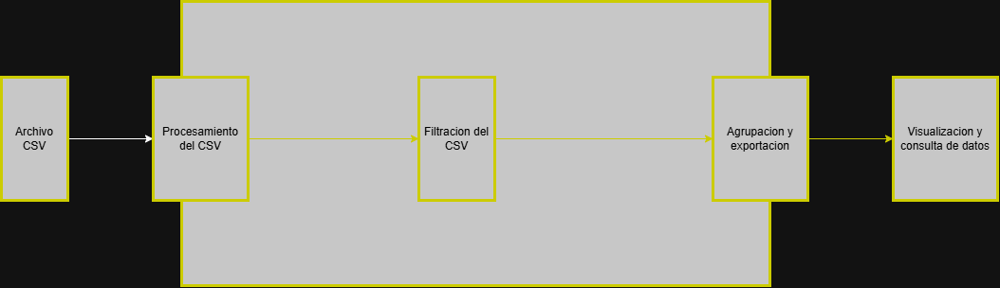

# AirTortilla - Sistema de Gestión y Distribución de Reservas

Sistema backend y frontend desarrollado para la aerolínea **AirTortilla** que permite procesar archivos de reservas aéreas, filtrarlas y dividirlas automáticamente en ficheros independientes según el **país de Destino**, resolviendo además colisiones de pasajeros coincidentes mediante identificadores y localizadores inequívocos.

## Captura de AirTortilla



---

## Descripción y Reglas de Negocio

El sistema procesa archivos estructurados `.csv` de reservas cargados por el usuario y aplica las siguientes reglas de negocio:

### 1. Formato de Columnas del Archivo CSV de Entrada

El archivo `.csv` subido debe contener exactamente la siguiente cabecera:

```
id,nombre_pasajero,origen,destino,pais_destino,fecha_reserva,localizador,precio,asiento
```

- **id**: Identificador de la reserva (si viene vacío, el sistema genera uno único e inequívoco).
- **nombre_pasajero**: Nombre completo del pasajero.
- **origen**: Ciudad o aeropuerto de origen.
- **destino**: Ciudad o aeropuerto de destino.
- **pais_destino**: Código ISO de 2 caracteres del país de destino (ej. `ES`, `FR`, `DE`, `IT`, `PT`, `GB`, `US`).
- **fecha_reserva**: Fecha en formato ISO `yyyy-MM-dd`.
- **localizador**: Código localizador del billete (si viene vacío o colisiona, el sistema asigna uno único).
- **precio**: Importe de la reserva.
- **asiento**: Código de asiento asignado.

### 2. División Exclusiva por País de Destino

- **Un único archivo por país**: Todas las reservas con el mismo código ISO de país de destino se agrupan en un único fichero, **sin importar la ciudad concreta de destino ni la fecha individual del vuelo**.
  - _Ejemplo_: Si hay un vuelo a Berlín (`destino=Berlin, pais_destino=DE`) y otro a Múnich (`destino=Munich, pais_destino=DE`), **ambos se incluyen en el mismo archivo de Alemania**.
  - `XX`: Código ISO de 2 letras en mayúsculas del país de destino.
  - `YYYY_MM_DD`: Fecha de generación del fichero.
  - _Ejemplos_: `AirTortilla_DE_2026_10_13.csv`, `AirTortilla_FR_2026_10_13.csv`, `AirTortilla_IT_2026_10_13.csv`.

- **Ubicación**: Los ficheros se generan en la carpeta `archivos_generados/`.

### 3. Identificación Inequívoca y Desambiguación de Pasajeros

- En escenarios donde **2 o más pasajeros coinciden en Nombre, Origen y Destino**, el sistema detecta la colisión y garantiza un **localizador diferenciado y persistente** para cada uno (ej. `AT-DE-C1A`, `AT-DE-C2B`).
- Garantiza identificadores (`id`) y localizadores (`localizador`) únicos para evitar duplicidades o billetes ambiguos.

### 4. Modalidades de Consulta en la Interfaz Web

- **Modalidad Total**: Permite consultar el fichero completo de un país, alternando entre vista de tabla estructurada y vista del texto CSV en bruto (_raw_), con opción de descarga directa.
- **Modalidad Línea a Línea**: Permite inspeccionar el fichero registro a registro, con controles de navegación (Inicio, Anterior, Siguiente, Fin), control deslizante (_slider_), modo _Auto-Play_ con velocidad ajustable, ficha detallada del billete y vista de la línea sin procesar.

---

## Stack Tecnológico

- **Lenguaje**: Java 21 (LTS).
- **Framework Principal**: Spring Boot 3.4.3 (`spring-boot-starter-web` con servidor Tomcat embebido).
- **Librería de Parseo**: OpenCSV 5.9 (`CsvToBeanBuilder` y `CSVWriter`).
- **Gestor de Construcción**: Maven (a través del wrapper incluido `mvnw`).
- **Frontend**: HTML5 semántico, CSS3 nativo (diseño responsive temático de aviación) y JavaScript Vanilla (`Fetch API`).

---

## Cómo Levantar el Proyecto

### 1. Requisitos Previos

- Tener instalado **JDK 21** configurado en el `PATH`.

### 2. Ejecución en Modo Desarrollo

Abre un terminal en la raíz del proyecto y ejecuta:

- **En Windows (PowerShell / CMD)**:

  ```powershell
  .\mvnw.cmd spring-boot:run
  ```

- **En Linux / macOS**:
  ```bash
  ./mvnw spring-boot:run
  ```

### 3. Puertos y Acceso Web

- **Puerto utilizado**: `8080` (configurado en `src/main/resources/application.properties`).
- **URL de acceso**: Abre tu navegador web en:
  **[http://localhost:8080](http://localhost:8080)**

---

## Resumen de la API REST

| Método   | Endpoint                                           | Descripción                                                                                          |
| :------- | :------------------------------------------------- | :--------------------------------------------------------------------------------------------------- |
| `GET`    | `/api/reservas`                                    | Devuelve el total de reservas cargadas, países únicos y análisis de coincidencias.                   |
| `POST`   | `/api/reservas/subir`                              | Sube un archivo CSV mediante `multipart/form-data` y genera automáticamente los ficheros por país.   |
| `POST`   | `/api/reservas/generar-archivos`                   | Regenera los archivos divididos por país a partir de las reservas activas.                           |
| `GET`    | `/api/reservas/archivos`                           | Lista los archivos generados con sus metadatos (tamaño, número de reservas, fecha).                  |
| `GET`    | `/api/reservas/archivos/{nombre}/total`            | Consulta un archivo en **Modalidad Total** (devuelve reservas estructuradas y texto CSV en bruto).   |
| `GET`    | `/api/reservas/archivos/{nombre}/linea?numero={n}` | Consulta un archivo en **Modalidad Línea a Línea** (devuelve el registro `n`, anterior y siguiente). |
| `GET`    | `/api/reservas/archivos/{nombre}/descargar`        | Descarga el archivo CSV físico generado.                                                             |
| `DELETE` | `/api/reservas/archivos`                           | Elimina todos los archivos generados en la carpeta `archivos_generados/`.                            |
