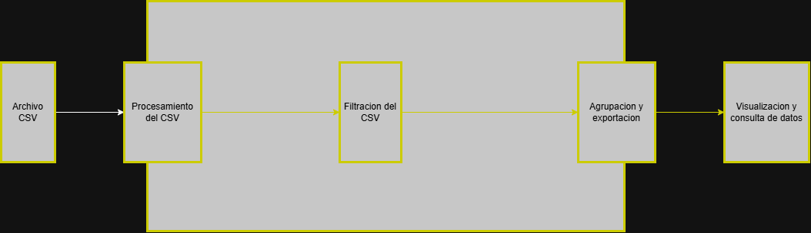

# AirTortilla - Sistema de Gestión y Distribución de Reservas

Sistema backend y frontend desarrollado para la aerolínea **AirTortilla** que permite procesar archivos de reservas aéreas, filtrarlas y dividirlas automáticamente en ficheros independientes según el **país de Destino**, resolviendo colisiones de pasajeros coincidentes y gestionando el control de acceso con autenticación en base de datos relacional y roles de usuario (**ADMIN** y **NORMAL**).

## Captura del Sistema



---

## Control de Acceso y Credenciales de Usuario

El sistema cuenta con un **módulo de autenticación bloqueante** al iniciar la página.

### 1. Credenciales Disponibles por Defecto

Al inicializar la aplicación, el sistema comprueba automáticamente la tabla `usuarios` y precarga las siguientes cuentas predeterminadas:

| Rol        | Usuario (_username_) | Contraseña (_password_) | Nombre Completo       | Permisos en la Aplicación                                                                                                                                                                                                        |
| :--------- | :------------------- | :---------------------- | :-------------------- | :------------------------------------------------------------------------------------------------------------------------------------------------------------------------------------------------------------------------------- |
| **ADMIN**  | `admin`              | `admin123`              | Administrador General | **Acceso total**: Puede usar todas las funciones de la página (cargar CSV, generar y consultar ficheros, descargar, etc.) y además **crear, editar y eliminar usuarios**.                                                        |
| **NORMAL** | `usuario`            | `user123`               | Usuario Operador      | **Uso operativo**: Solo puede utilizar las funciones de la página (reservas, particionado, descargas). **No puede gestionar usuarios** (la pestaña está oculta y el backend devuelve `403 Forbidden` si intenta invocar la API). |

## Matriz de Permisos por Rol

| Funcionalidad / Módulo                               | Usuario Normal (`NORMAL`) |        Administrador (`ADMIN`)         |
| :--------------------------------------------------- | :-----------------------: | :------------------------------------: |
| Iniciar sesión con validación en BD `usuarios`       |            Sí             |                   Sí                   |
| Subir archivos `.csv` de reservas                    |            Sí             |                   Sí                   |
| Visualizar reservas y KPIs en tiempo real            |            Sí             |                   Sí                   |
| Dividir y generar archivos por país de destino       |            Sí             |                   Sí                   |
| Consultar en **Modalidad Total** y **Línea a Línea** |            Sí             |                   Sí                   |
| Descargar archivos `.csv` generados                  |            Sí             |                   Sí                   |
| Ver listado de usuarios del sistema                  |            No             |                   Sí                   |
| Crear nuevos usuarios en la BD                       |            No             |                   Sí                   |
| Modificar usuarios existentes y roles                |            No             |                   Sí                   |
| Eliminar usuarios de la base de datos                |            No             | Sí (Protegido contra auto-eliminación) |

---

## Cómo Funciona la Base de Datos Relacional (H2 + JPA/Hibernate)

### 1. Arquitectura y Almacenamiento

- **Motor**: **H2 Database Engine** (`com.h2database:h2`) ejecutándose en modo embebido sobre disco local.
- **Archivo de base de datos**: `./data/airtortilla_db.mv.db` (creado automáticamente en la carpeta `data/` de la raíz del proyecto).
- **Capa de Abstracción ORM**: **Spring Data JPA** respaldado por **Hibernate 6**. Permite definir modelos como entidades Java mediante anotaciones (`@Entity`, `@Table`, `@Column`, `@Id`, etc.) y generar automáticamente el esquema de tablas relacionales.
- **Configuración de Persistencia**:
  - `spring.jpa.hibernate.ddl-auto=update`: Hibernate comprueba la base de datos al arrancar y actualiza o crea las tablas necesarias (`usuarios`, `reservas`) sin destruir los datos existentes.
  - `spring.datasource.url=jdbc:h2:file:./data/airtortilla_db;DB_CLOSE_DELAY=-1;DB_CLOSE_ON_EXIT=FALSE;AUTO_RECONNECT=TRUE`

---

## Estructura de las Tablas en la Base de Datos

### Tabla 1: `usuarios`

Gestiona las cuentas de acceso y sus niveles de privilegio en el sistema:

| Columna    | Tipo SQL H2    | Clave / Restricción             | Descripción                                         |
| :--------- | :------------- | :------------------------------ | :-------------------------------------------------- |
| `id`       | `BIGINT`       | **PRIMARY KEY**, AUTO_INCREMENT | Identificador numérico autoincremental del usuario. |
| `username` | `VARCHAR(50)`  | **UNIQUE**, NOT NULL            | Nombre de usuario único para el inicio de sesión.   |
| `password` | `VARCHAR(100)` | NOT NULL                        | Contraseña de autenticación.                        |
| `nombre`   | `VARCHAR(100)` | NOT NULL                        | Nombre y apellidos o descripción del titular.       |
| `rol`      | `VARCHAR(20)`  | NOT NULL                        | Rol asignado: `'ADMIN'` o `'NORMAL'`.               |

### Tabla 2: `reservas`

Almacena todas las reservas importadas desde ficheros `.csv`:

| Columna           | Tipo SQL H2    | Clave / Restricción       | Descripción                                                            |
| :---------------- | :------------- | :------------------------ | :--------------------------------------------------------------------- |
| `id`              | `VARCHAR(60)`  | **PRIMARY KEY**, NOT NULL | Identificador único inequívoco de la reserva.                          |
| `nombre_pasajero` | `VARCHAR(255)` | NOT NULL                  | Nombre completo del pasajero.                                          |
| `origen`          | `VARCHAR(255)` | NOT NULL                  | Aeropuerto o ciudad de origen.                                         |
| `destino`         | `VARCHAR(255)` | NOT NULL                  | Aeropuerto o ciudad de destino.                                        |
| `pais_destino`    | `VARCHAR(10)`  | NOT NULL                  | Código ISO de 2 caracteres del país de destino (ej. `ES`, `FR`, `IT`). |
| `fecha_reserva`   | `DATE`         | NOT NULL                  | Fecha de expedición del billete (`yyyy-MM-dd`).                        |
| `localizador`     | `VARCHAR(50)`  | Nullable                  | Localizador único o desambiguado.                                      |
| `precio`          | `FLOAT(53)`    | Nullable                  | Importe del billete en euros (€).                                      |
| `asiento`         | `VARCHAR(20)`  | Nullable                  | Asiento asignado al vuelo.                                             |

---

## Cómo Consulta la Aplicación a la Base de Datos

El flujo de consulta sigue un patrón de diseño en capas desacopladas:

```
[ Navegador Web / Interfaz ]
         │ (Petición HTTP Fetch / JSON)
         ▼
[ Controladores REST: AuthController / UsuarioController / ReservaController ]
         │ (Invocación de métodos de servicio)
         ▼
[ Capa de Servicio: UsuarioService / ReservaManagerService ]
         │ (Lógica de negocio, validaciones y transacciones @Transactional)
         ▼
[ Repositorios Spring Data JPA: UsuarioRepository / ReservaRepository ]
         │ (Traducción de métodos derivados a sentencias SQL parametrizadas)
         ▼
[ Hibernate Core / HikariCP Pool ]
         │ (Conexión JDBC org.h2.Driver)
         ▼
[ Motor de Base de Datos H2 (./data/airtortilla_db.mv.db) ]
```

1. **Recepción de la petición**: El cliente web envía una petición (ej. `POST /api/auth/login` con el usuario y la contraseña en formato JSON).
2. **Validación en el Servicio**: `UsuarioService.autenticar(username, password)` procesa la solicitud y valida los parámetros de entrada.
3. **Ejecución a través del Repositorio**: Se invoca el método derivado de `UsuarioRepository`:
   ```java
   Optional<Usuario> findByUsernameIgnoreCase(String username);
   ```
4. **Traducción a SQL por Hibernate**: Spring Data JPA y Hibernate transforman el método en una consulta SQL nativa con marcadores de posición (`?`), previniendo cualquier intento de inyección SQL.
5. **Comprobación de credenciales**: Si la consulta devuelve un registro, el servicio valida la correspondencia de la contraseña y retorna la entidad mapeada.
6. **Gestión de la Sesión**: Si la validación es correcta, el `AuthController` guarda el objeto usuario en la `HttpSession` HTTP (`session.setAttribute("USUARIO_ACTIVO", usuario)`).

---

## Catálogo de Consultas SQL Ejecutadas por el Sistema

A continuación se detalla el conjunto exacto de sentencias SQL ejecutadas sobre el motor H2:

### 1. Consultas sobre la Tabla `usuarios`

#### A. Comprobación de Usuario en el Login

Se consulta si el usuario existe en la tabla `usuarios` (ignorando mayúsculas/minúsculas):

```sql
SELECT u.id, u.username, u.password, u.nombre, u.rol
FROM usuarios u
WHERE LOWER(u.username) = LOWER(?);
```

_También se soporta la verificación directa por credenciales compuestas:_

```sql
SELECT * FROM usuarios WHERE username = ? AND password = ?;
```

#### B. Comprobación de Existencia de un Usuario

Utilizada al dar de alta un nuevo usuario o durante el arranque inicial:

```sql
SELECT COUNT(*) > 0 FROM usuarios WHERE username = ?;
```

#### C. Comprobación de Nombre de Usuario Duplicado en Edición

Garantiza que ningún otro usuario tenga ya ese nombre al modificar una cuenta:

```sql
SELECT COUNT(*) > 0 FROM usuarios WHERE username = ? AND id <> ?;
```

#### D. Listar Todos los Usuarios Registrados (Exclusivo Administrador)

```sql
SELECT id, username, nombre, rol FROM usuarios ORDER BY id ASC;
```

#### E. Obtener un Usuario por su ID

```sql
SELECT * FROM usuarios WHERE id = ?;
```

#### F. Insertar un Nuevo Usuario (Creación por Administrador o Inicialización)

```sql
INSERT INTO usuarios (username, password, nombre, rol)
VALUES (?, ?, ?, ?);
```

#### G. Modificar Datos de un Usuario Existente (Edición)

```sql
UPDATE usuarios
SET username = ?, password = ?, nombre = ?, rol = ?
WHERE id = ?;
```

#### H. Eliminar un Usuario (Borrado por Administrador)

```sql
DELETE FROM usuarios WHERE id = ?;
```

#### I. Conteo de Administradores del Sistema

Se ejecuta antes de eliminar o degradar un administrador para proteger al sistema contra la pérdida del último administrador:

```sql
SELECT COUNT(*) FROM usuarios WHERE rol = 'ADMIN';
```

---

### 2. Consultas sobre la Tabla `reservas`

#### A. Consultar Todas las Reservas

```sql
SELECT * FROM reservas;
```

#### B. Filtrar Reservas por Código ISO de País de Destino

```sql
SELECT * FROM reservas WHERE pais_destino = ?;
```

#### C. Inserción o Actualización de Reservas Importadas desde CSV

```sql
MERGE INTO reservas KEY(id)
VALUES (?, ?, ?, ?, ?, ?, ?, ?, ?);
```

#### D. Resumen Estadístico de Reservas Agrupadas por País

```sql
SELECT pais_destino, COUNT(*) AS total_reservas
FROM reservas
GROUP BY pais_destino
ORDER BY total_reservas DESC;
```

---

## Acceso Directo a la Consola Web de H2

Puedes inspeccionar directamente las tablas y ejecutar consultas SQL manuales mediante la consola integrada:

- **URL de la Consola**: [http://localhost:8080/h2-console](http://localhost:8080/h2-console)
- **Parámetros de Conexión**:
  - **Saved Settings**: `Generic H2 (Embedded)`
  - **Driver Class**: `org.h2.Driver`
  - **JDBC URL**: `jdbc:h2:file:./data/airtortilla_db`
  - **User Name**: `sa`
  - **Password**: _(dejar en blanco)_

---

## Cómo Levantar el Proyecto

### 1. Requisitos Previos

- Tener instalado **JDK 21** configurado en las variables de entorno (`JAVA_HOME` y `PATH`).

### 2. Ejecución de la Aplicación

Abre un terminal en la raíz del proyecto y ejecuta:

- **En Windows (PowerShell / CMD)**:

  ```powershell
  mvnw spring-boot:run
  ```

- **En Linux / macOS**:
  ```bash
  mvnw spring-boot:run
  ```

### 3. Ejecución de la Batería de Pruebas Automatizadas

Para validar todos los tests unitarios y de integración (incluyendo flujo de login, control de acceso de roles y CRUD de usuarios):

```powershell
mvnw test
```

### 4. Acceso en el Navegador

Abre tu navegador en:
**[http://localhost:8080](http://localhost:8080)**

1. Verás de inmediato la **pantalla de Login**.
2. Pulsa en el botón **👑 ADMIN** o introduce `admin` / `admin123` para entrar con privilegios totales.
3. Si entras con `usuario` / `user123` podrás consultar y utilizar la aplicación, pero no verás ni podrás acceder al módulo de gestión de usuarios.

---

## Catálogo de Endpoints de la API REST

### Módulo de Autenticación (`/api/auth`)

| Método | Endpoint            | Acceso Requerido | Descripción                                                                                                |
| :----- | :------------------ | :--------------- | :--------------------------------------------------------------------------------------------------------- |
| `POST` | `/api/auth/login`   | Público          | Autentica las credenciales comprobando la tabla `usuarios` en la base de datos H2 e inicia la sesión HTTP. |
| `GET`  | `/api/auth/session` | Público          | Devuelve los datos del usuario con sesión activa en el navegador o código `401 Unauthorized`.              |
| `POST` | `/api/auth/logout`  | Autenticado      | Invalida la sesión activa y bloquea el acceso en la interfaz.                                              |

### Módulo de Gestión de Usuarios (`/api/usuarios`)

| Método   | Endpoint             | Acceso Requerido | Descripción                                                                                     |
| :------- | :------------------- | :--------------- | :---------------------------------------------------------------------------------------------- |
| `GET`    | `/api/usuarios`      | **ADMIN**        | Lista todos los usuarios registrados en la tabla `usuarios` (retorna DTO seguro sin passwords). |
| `GET`    | `/api/usuarios/{id}` | **ADMIN**        | Obtiene el detalle de un usuario por su identificador.                                          |
| `POST`   | `/api/usuarios`      | **ADMIN**        | Registra un nuevo usuario en la base de datos (con rol `ADMIN` o `NORMAL`).                     |
| `PUT`    | `/api/usuarios/{id}` | **ADMIN**        | Actualiza nombre, username, rol o contraseña de un usuario existente.                           |
| `DELETE` | `/api/usuarios/{id}` | **ADMIN**        | Elimina permanentemente a un usuario de la base de datos (protegido contra auto-borrado).       |

### Módulo de Reservas y Archivos (`/api/reservas`)

| Método   | Endpoint                                           | Acceso Requerido | Descripción                                                                                               |
| :------- | :------------------------------------------------- | :--------------- | :-------------------------------------------------------------------------------------------------------- |
| `GET`    | `/api/reservas`                                    | Autenticado      | Devuelve el listado de reservas desde la base de datos H2 (con filtro opcional `?pais=XX`).               |
| `GET`    | `/api/reservas/pais/{codigoPais}`                  | Autenticado      | Consulta reservas filtradas por código ISO de país destino directamente en la BD H2.                      |
| `POST`   | `/api/reservas/subir`                              | Autenticado      | Sube un CSV mediante `multipart/form-data`, lo persiste en H2 y genera los ficheros particionados.        |
| `POST`   | `/api/reservas/generar-archivos`                   | Autenticado      | Regenera los archivos divididos por país a partir de las reservas activas en la BD.                       |
| `GET`    | `/api/reservas/archivos`                           | Autenticado      | Lista los archivos generados con sus metadatos calculados desde la base de datos.                         |
| `GET`    | `/api/reservas/archivos/{nombre}/total`            | Autenticado      | Consulta en **Modalidad Total** leyendo directamente desde la base de datos H2.                           |
| `GET`    | `/api/reservas/archivos/{nombre}/linea?numero={n}` | Autenticado      | Consulta en **Modalidad Línea a Línea** registro a registro desde la BD H2.                               |
| `GET`    | `/api/reservas/archivos/{nombre}/descargar`        | Autenticado      | Descarga el archivo CSV físico generado (o generado al vuelo si no existiese).                            |
| `GET`    | `/api/reservas/coincidencias`                      | Autenticado      | Lista los grupos de pasajeros coincidentes (mismo Nombre, Origen y Destino) con sus localizadores únicos. |
| `DELETE` | `/api/reservas/archivos`                           | Autenticado      | Elimina todos los archivos generados en la carpeta `archivos_generados/`.                                 |

---

## Reglas de Negocio de AirTortilla

### 1. Formato de Columnas del Archivo CSV de Entrada

El archivo `.csv` subido debe contener exactamente la siguiente cabecera:

```
id,nombre_pasajero,origen,destino,pais_destino,fecha_reserva,localizador,precio,asiento
```

- **id**: Identificador de la reserva (si viene vacío, el sistema genera uno único e inequívoco).
- **nombre_pasajero**: Nombre completo del pasajero.
- **origen**: Ciudad o aeropuerto de origen.
- **destino**: Ciudad o aeropuerto de destino.
- **pais_destino**: Código ISO de 2 caracteres del país de destino (ej. `ES`, `FR`, `DE`, `IT`, `PT`, `GB`, `US`).
- **fecha_reserva**: Fecha en formato ISO `yyyy-MM-dd`.
- **localizador**: Código localizador del billete (si viene vacío o colisiona, el sistema asigna uno único).
- **precio**: Importe de la reserva.
- **asiento**: Código de asiento asignado.

### 2. División Exclusiva por País de Destino

- **Un único archivo por país**: Todas las reservas con el mismo código ISO de país de destino se agrupan en un único fichero, **sin importar la ciudad concreta de destino ni la fecha individual del vuelo**.
  - _Ejemplo_: Si hay un vuelo a Berlín (`destino=Berlin, pais_destino=DE`) y otro a Múnich (`destino=Munich, pais_destino=DE`), **ambos se incluyen en el mismo archivo de Alemania**.
  - Formato del nombre de archivo: `AirTortilla_XX_YYYY_MM_DD.csv`
    - `XX`: Código ISO de 2 letras en mayúsculas del país de destino.
    - `YYYY_MM_DD`: Fecha de generación del fichero.
    - _Ejemplos_: `AirTortilla_DE_2026_10_13.csv`, `AirTortilla_FR_2026_10_13.csv`, `AirTortilla_IT_2026_10_13.csv`.

### 3. Identificación Inequívoca y Desambiguación de Pasajeros

- En escenarios donde **2 o más pasajeros coinciden en Nombre, Origen y Destino**, el sistema detecta la colisión y garantiza un **localizador diferenciado y persistente** para cada uno (ej. `AT-DE-C1A`, `AT-DE-C2B`).
- Garantiza identificadores (`id`) y localizadores (`localizador`) únicos para evitar duplicidades o billetes ambiguos.
